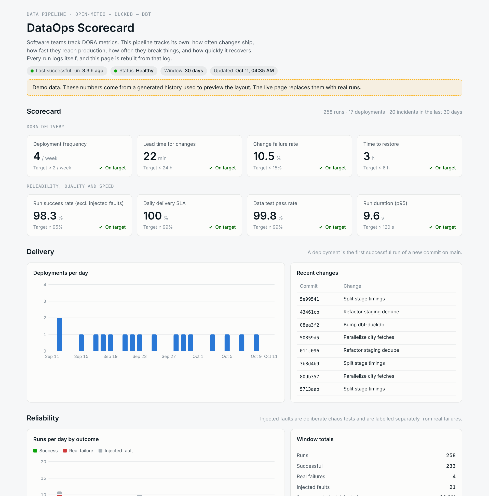
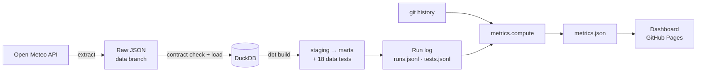

# DataOps Scorecard

**Software teams track DORA metrics. Most data teams don't.** This project is a small, real data pipeline that measures its own delivery performance, reliability, data quality and speed, and publishes the results as a live dashboard.

**Live dashboard:** https://pawan8080.github.io/dataops-scorecard/



## What it does

Every 3 hours, GitHub Actions runs a pipeline that pulls daily weather for six cities from the [Open-Meteo API](https://open-meteo.com/), loads it into DuckDB, and transforms and tests it with dbt. The weather is just the payload. The point is what the pipeline records about itself:

- every run, with its trigger, commit, stage timings, row counts and outcome
- every dbt data test, pass or fail
- every failure, including deliberately injected ones

From that log, the scorecard computes four groups of metrics and checks them against team-defined targets.

| Group | Metrics |
|---|---|
| **DORA delivery** | Deployment frequency, lead time for changes, change failure rate, time to restore |
| **Reliability** | Run success rate, daily delivery SLA, incidents |
| **Data quality** | Test pass rate, most frequently failing checks, schema contract violations |
| **Performance** | Run duration (median and p95), time per stage, rows processed, compute minutes |

## Architecture



| Layer | Tool | Where |
|---|---|---|
| Orchestration | GitHub Actions (cron + push + manual) | `.github/workflows/pipeline.yml` |
| Extract | Python + requests | `pipeline/ingest.py` |
| Data contract + load | Python + DuckDB | `pipeline/load.py` |
| Transform + test | dbt-duckdb | `dbt/` |
| Run logging | Python | `pipeline/run.py` |
| Fault injection | Python | `pipeline/faults.py` |
| Metrics | Python | `metrics/compute.py`, `metrics/targets.json` |
| Dashboard | HTML + SVG, no framework | `dashboard/index.html` |

**State lives on a separate `data` branch.** Raw API responses and the run log are committed there after every run, so `main` holds only code and every commit on `main` is a real change. The DuckDB warehouse is rebuilt from raw files on every run, so it can never drift from source.

## Metric definitions

| Metric | Definition |
|---|---|
| Deployment | The first successful run of a new commit on `main` |
| Deployment frequency | Deployments per week over the last 30 days |
| Lead time for changes | Commit authored to its deployment (median). A commit deploys with the first successful run that contains it |
| Change failure rate | Share of new commits whose first run failed for a real reason. Injected faults are excluded |
| Time to restore | First failed run of an incident to the next successful run (median) |
| Run success rate | Successful runs over all runs, excluding injected faults |
| Daily delivery SLA | Share of days with at least one successful run |
| Test pass rate | Passed dbt tests over executed tests (skipped tests are excluded) |

Targets are team-defined SLOs in [`metrics/targets.json`](metrics/targets.json). Each scorecard tile shows **On target**, **At risk** (within 10%) or **Off target**.

## Failure injection

A pipeline that never fails gives you nothing to measure recovery against. About 8% of scheduled runs inject one of four realistic faults:

| Fault | Simulates | Caught by |
|---|---|---|
| `schema_change` | Upstream renames a field | Data contract check in the load stage |
| `bad_values` | Impossible sensor reading (999 °C) | dbt `value_between` test |
| `late_data` | Source stops delivering recent days | Freshness test on the latest run |
| `api_timeout` | Upstream API does not respond | Ingest stage |

Faults are applied in memory to the current run only. Raw files always hold what the source actually sent, so the next clean run recovers on its own. Every injected fault is labelled in the run log and shown separately on the dashboard, so chaos testing never inflates the real failure numbers.

When a source test fails, dbt skips every model downstream of it. Bad data stops at staging and never reaches the marts.

You can inject a fault on demand: **Actions → pipeline → Run workflow → choose a fault**.

## Run it locally

```bash
python -m venv .venv && source .venv/bin/activate
pip install -r requirements.txt

# One real run against the API (writes to ./state)
python -m pipeline.run --state-dir state

# Try a fault
python -m pipeline.run --state-dir state --fault bad_values

# Compute metrics and build the site
python -m metrics.compute --state-dir state --out dashboard/data/metrics.json
python scripts/build_site.py --out site
python -m http.server -d site 8000   # open http://localhost:8000
```

Add `--offline` to `pipeline.run` to use a generated fixture instead of the API.

To preview the dashboard with a full history before real runs accumulate, generate a demo log. Every record is tagged as demo and the dashboard shows a banner:

```bash
python scripts/seed_demo.py --state-dir demo_state
python -m metrics.compute --state-dir demo_state --out dashboard/data/metrics.json
```

## Setup on GitHub

1. **Settings → Pages → Build and deployment → Source: GitHub Actions.**
2. **Settings → Actions → General → Workflow permissions: Read and write.**
3. Push to `main`. The first run creates the `data` branch and publishes the dashboard.

GitHub pauses scheduled workflows in repositories with no activity for 60 days. The run history commits keep the repository active, but if runs ever stop, re-enable the workflow from the Actions tab.

## Project structure

```
dataops-scorecard/
├── .github/workflows/pipeline.yml   # schedule, push and manual triggers
├── pipeline/
│   ├── config.py                    # cities, fields (the data contract), faults
│   ├── ingest.py                    # extract from Open-Meteo
│   ├── load.py                      # contract check + DuckDB load
│   ├── faults.py                    # labelled fault injection
│   └── run.py                       # orchestrates a run and logs it
├── dbt/
│   ├── models/staging/              # dedupe + typing, source and column tests
│   ├── models/marts/                # fct_daily_weather, agg_city_monthly
│   └── tests/                       # freshness, min/max sanity, generic tests
├── metrics/
│   ├── compute.py                   # run log → metrics.json
│   └── targets.json                 # team-defined SLO targets
├── dashboard/index.html             # the scorecard page
└── scripts/
    ├── build_site.py                # wraps the page for GitHub Pages
    └── seed_demo.py                 # labelled demo history for previews
```

## Limitations

- Lead time starts at commit authoring. Without pull requests, review time is not measured separately.
- Time to restore is bounded below by the 3-hour schedule, because recovery happens on the next scheduled run.
- Duration measures the pipeline itself, not GitHub Actions setup time.
- Weather data is the payload, not the subject. The same scaffolding works for any source.

## License

MIT
